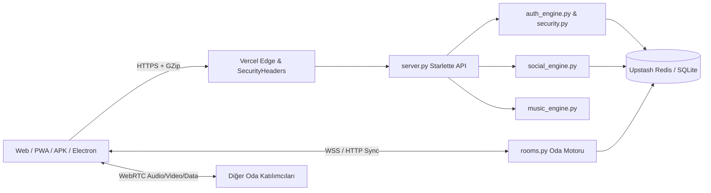

# Watchlivo (`watchlivo.online`) — Kapsamlı Mimari ve Tam Yığın Denetim Raporu (`v134`)

- **Denetim Tarihi:** 6 Kasım 2026
- **Hedef Sürüm:** `20261106_v134`
- **Çalışma Alanı:** `c:\Users\pc\Documents\projelerim\rave_web_platform`
- **Canlı Ortam:** `https://watchlivo.online` (Özel GitHub Deposu: `mephisto-mert/watchlivo`)
- **Denetim Kapsamı:** Mimari, Backend API, Gerçek Zamanlı Oda Senkronizasyonu, WebRTC Ses/Kamera, Medya Oynatıcılar, Frontend SPA, UI/UX, WCAG 2.1 AA Erişilebilirlik, 21 Ekran Çözünürlüğü (Responsive), Çoklu Tarayıcı & Masaüstü/Mobil Uyumluluk, Performans ve Güvenlik.

---

## 1. Projenin Amacı ve Temel İşlevleri

**Watchlivo**, kullanıcıların fiziksel olarak farklı konumlarda olsalar dahi aynı anda saliselik senkronizasyonla film, dizi, anime, YouTube videoları, müzik (Watchlivo DJ / Karaokeli Şarkı Sözleri) ve 7/24 canlı TV kanallarını birlikte izleyebildiği çok platformlu bir **Watch Party & Sosyal Sinema** uygulamasıdır.

Temel yetenekler:
1. **Gerçek Zamanlı İzleme Odaları (`Mesh`):** Lider (`leader`) veya ortak kontrol (`all`) modları, şifreli/gizli odalar, yardımcı yönetici (`Co-Host`) devri, oylama (`poll`), geçme oylaması (`vote_skip`), mola isteği ve 100+ kişilik büyük oda yayın modu (`largeRoomMode`).
2. **Hibrit Senkronizasyon Protokolü:** WebSocket (`/ws/{room_id}`), HTTP durum senkronizasyonu (`/api/rooms/{room_id}/sync`), kriptografik imzalı durum jetonu (`syncToken` — sunucusuz soğuk başlangıç kurtarma) ve WebRTC DataChannel P2P senkronizasyon katmanı.
3. **WebRTC Sesli/Görüntülü Sohbet & Sesli Notlar:** Oda içi düşük gecikmeli P2P mikrofon/kamera, sunucu tabanlı ses rölesi yedeklemesi (`/api/rave/voice-relay/{room_id}`), evrensel WAV/MediaRecorder sesli not gönderimi ve canlı danmaku/emoji tepkileri.
4. **Sosyal Ağ, Hesap ve İzleme Geçmişi:** `@kullaniciadi` (Türkçe karakter normalizasyonlu), arkadaş ekleme/kabul, özel mesajlaşma (DM), oda daveti, bulut tabanlı kaldığın saniyeden devam etme (`epProgress`) ve izleme listesi (`watchlist`).
5. **Çoklu Platform Dağıtımı:** Web SPA + PWA (`sw.js`, `manifest.json`), Android Native APK (`Watchlivo-v2.0.apk`), iOS Native ARM64 IPA (`Watchlivo-v2.0.ipa` + OTA `manifest.plist`) ve Windows/macOS/Linux Electron istemcisi (`desktop/main.js`).

---

## 2. Teknoloji Yığını ve Mimari Harita

| Katman | Teknoloji / Kütüphane | Rolü ve Konumu |
| :--- | :--- | :--- |
| **Backend Çatısı** | Python 3.12 + **Starlette** + **Uvicorn** | Asenkron HTTP, WebSocket, Middleware ve Proxy sunucusu (`server.py`). |
| **Oda & Senkron Motoru** | Özel Durum Makinesi (`rooms.py`) | Oda yaşam döngüsü, katılımcı yetkileri, `syncToken` HMAC paketleme ve saat kayması telafisi. |
| **Kimlik Doğrulama** | `auth_engine.py` + `security.py` | PBKDF2/Scrypt şifre özetleme, HMAC-SHA256 oturum jetonu, sunucu taraflı jeton iptali (`revoke_auth_token`), hız sınırlayıcılar (`RateLimiter`). |
| **Sosyal & Medya Motoru** | `social_engine.py` + `music_engine.py` | Arkadaşlık/DM/bildirim grafiği, sesli notlar, YouTube/iTunes müzik ve şarkı sözü (VTT) motoru. |
| **Veri Katmanı** | **Upstash Redis** (Üretim) + **SQLite** (Yerel/Yedek) | Sunucusuz ortamda kalıcı KV saklama, yerel geliştirmede `rave_platform.db` ve `/tmp` önbelleği. |
| **Frontend Çekirdeği** | Sıfır Derleme (Zero-Build) **Vanilla ES Modules** | `static/js/main.js`, `store.js`, `ui.js`, `realtime.js`, `sync.js`, `voice.js`, `accounts.js`. |
| **Medya Oynatıcılar** | `hls.js`, HTML5 `<video>`, YouTube IFrame, WebAudio | `static/js/players/` (`host.js`, `html5.js`, `youtube.js`, `embed.js`, `audio-gain.js`, `subtitles.js`). |
| **Tasarım Sistemi** | Özel CSS Değişkenleri + 8 Dinamik Tema | `static/css/vortex.css` (Lobi/Ana Sayfa) ve `static/css/mesh.css` (Oda/Sinema Sahnesi). |
| **Masaüstü Kabuğu** | **Electron** (`desktop/main.js`) | Widevine DRM uyumlu, tekil örnek kilitli (`requestSingleInstanceLock`) ve `sandbox: true` masaüstü istemcisi. |
| **Dağıtım & Edge** | **Vercel** (`vercel.json` + `@vercel/python`) | Edge yönlendirme, güvenlik başlıkları ve sunucusuz Python çalışma zamanı. |

---

## 3. Mimari Veri Akışı

---

## 4. Veri Modelleri, Kimlik Doğrulama ve Ortam Değişkenleri

### 4.1 Temel Veri Modelleri
- **Kullanıcı (`watchlivo_users` / Redis `wl:user:{uid}`):** `uid` (`u_wl_*` veya `guest_*`), `name`, `handle` (küçük harf ASCII/Türkçe normalize), `email`, `password_hash` (`pbkdf2_sha256` / `scrypt`), `color`, `avatar`, `bio`, `created_at`.
- **İzleme Odası (`rooms.STORE` / `syncToken`):** `id`, `name`, `privacy` (`public`/`private`/`friends`), `playMode` (`leader`/`all`), `password` (SHA-256 özet veya düz metin doğrulama), `creatorCid`, `host_id`, `co_hosts`, `banned_ids` (`cid` + `uid:<u_wl_...>`), `media` (`url`, `provider`, `tmdbId`, `season`, `episode`, `currentTime`, `meshStatePosition`, `meshStateTime`, `playing`, `rate`), `queue`, `chat`, `poll`.
- **Kullanıcı Kişiselleştirme (`social_engine.py`):** `wl:progress:{uid}` (bölüm ve saniye bazlı `epProgress`), `wl:watchlist:{uid}`, `wl:music_hist:{uid}`, `wl:friends:{uid}`, `wl:dm:{pair_key}`.

### 4.2 Kimlik Doğrulama ve Yetkilendirme Mimarisi
- **Üye Oturumları:** `auth_engine.py` üzerinden HMAC-SHA256 imzalı `authToken` üretilir. `v133` ile birlikte `/api/auth/logout` çağrısında jeton imzası `_REVOKED_AUTH_SIGS` listesine alınarak ve `server._UID_CACHE` önbelleğinden silinerek sunucu tarafında anında geçersiz kılınır.
- **Oda Yetkileri:** Kurucu (`creatorCid`), aktif yönetici (`host_id`) ve yardımcı yöneticiler (`co_hosts`) ayrıştırılmıştır. Her istekte HMAC tabanlı `clientToken` doğrulanır; `v133` ile yeni açılmış odalardaki `_precreated` yer tutucusunun yetkisiz `close_room` / `host_action` paketleriyle ele geçirilmesi engellenmiştir.

### 4.3 Ortam Değişkenleri ve Dağıtım Yapılandırması
- `VORTEX_SECRET` / `AUTH_SECRET`: HMAC imzalama sırları (`security.py` içinde tahmin edilebilir sabit veya alan adı türevleri `v133` ile tamamen kaldırılmıştır).
- `UPSTASH_REDIS_REST_URL` / `UPSTASH_REDIS_REST_TOKEN` (veya `KV_REST_API_*`): Sunucusuz kalıcı veri katmanı.
- `ADMIN_SECRET`: Analitik GA4 kimliği değiştirme ve maskelenmemiş iletişim kayıtları için yönetici anahtarı.
- `TMDB_API_KEY`, `FIREBASE_WEB_API_KEY`: Katalog metaverisi ve isteğe bağlı OAuth doğrulama entegrasyonları.

---

## 5. Başlangıçtaki Teknik Borçlar ve Denetim Özeti

Denetim başlangıcında 5 paralel uzman alt ajan ve canlı tarayıcı/API taramalarıyla **toplam 45 bulgu** (`7 P0 Kritik`, `14 P1 Yüksek`, `16 P2 Orta`, `8 P3 Düşük`) tespit edilmiştir:

| Alan | Başlangıç Durumu (Önce) | `v133`–`v134` Onarım Sonrası (Sonra) |
| :--- | :--- | :--- |
| **Kriptografi, Sıkı CSP & Oturum** | Tahmin edilebilir yedek sır riski; `script-src` içinde `'unsafe-inline'`; çıkışta (`logout`) jeton sunucuda geçerli kalıyordu; paylaşımlı cihazda `VAULT_KEY` kalıntısı vardı. | Yalnızca gerçek entropi/CSPRNG sırları (`ADMIN_SECRET` + `VORTEX_SECRET`); `script-src` `'unsafe-inline'` kaldırıldı + istek bazlı `'nonce-...'` CSP; tek-RTT Lua `RateLimiter`; `/api/auth/logout` jeton iptali. |
| **Oda Güvenliği & Senkron** | Bozuk JSON `200 OK` ile oda açıyordu; `_precreated` oda dışarıdan kapatılabiliyordu; P2P `sync` paketi lider taklidi yapabiliyordu; `sync.stop()` bayrağı sıfırlamıyordu. | Bozuk JSON `400`; `_precreated` yetki gaspı engellendi; P2P `sync` yalnızca lider/co-host kabul ediyor; UID bazlı `kick` yasağı eklendi. |
| **Performans, Kod Bölme & Ağ** | GZip kapalıydı (`~1.39 MB` JS + `~438 KB` CSS ham transfer); oda/oynatıcı modülleri ve `hls.min.js` ana sayfada peşin indiriliyordu; sınırsız büyüyen önbellek sözlükleri vardı. | `SelectiveGZipMiddleware` + dinamik `import('./views/mesh.js')` + isteğe bağlı `hls-loader.js` ile ana sayfa ilk JS yükü **`165.1 KB` GZip** (**-%88.1**); tüm önbelleklere LRU sınırları kondu. |
| **WCAG 2.1 AA & Klavye** | `maximum-scale=1, user-scalable=no` yakınlaştırmayı kilitliyordu; `indigo`/`graphite` tema kontrastı `3.68:1` idi; modallarda odak tuzağı yoktu; zaman çizelgesi klavyesizdi. | Yakınlaştırma kilidi kaldırıldı; tüm 8 temada kontrast `>= 4.5:1`; `popup()` odak tuzağı + `Escape` + odak geri yükleme; `#ctl-timeline` `role="slider"` + klavye sarma. |
| **Mobil, Safari & Çoklu Cihaz** | Mobil girdiler `10.8px–11px` (iOS otomatik yakınlaştırma hatası); 12 noktada eksik `-webkit-backdrop-filter`; `320px` ve yatay modda taşma riskleri. | Dokunmatik ekranlarda tüm girdiler `16px`, hedefler `>= 32px`; tüm cam yüzeylerde `-webkit-backdrop-filter`; 21 çözünürlükte `0px` yatay taşma. |
| **Masaüstü (Electron) & Yükleme** | `sandbox` kapalı, tekil örnek kilidi yok, sabit Windows UA; `/api/upload` yalnızca uzantıya bakıyordu. | `sandbox: true`, `requestSingleInstanceLock`, dinamik OS UA; `/api/upload` sihirli bayt (magic-byte) doğrulaması. |
